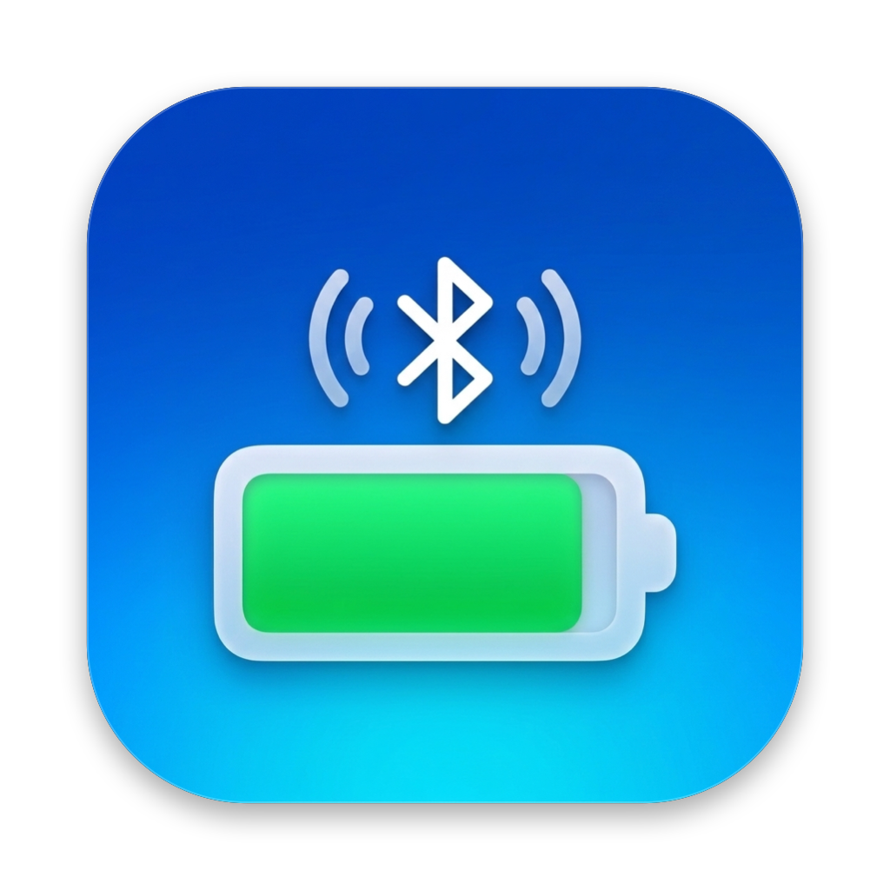
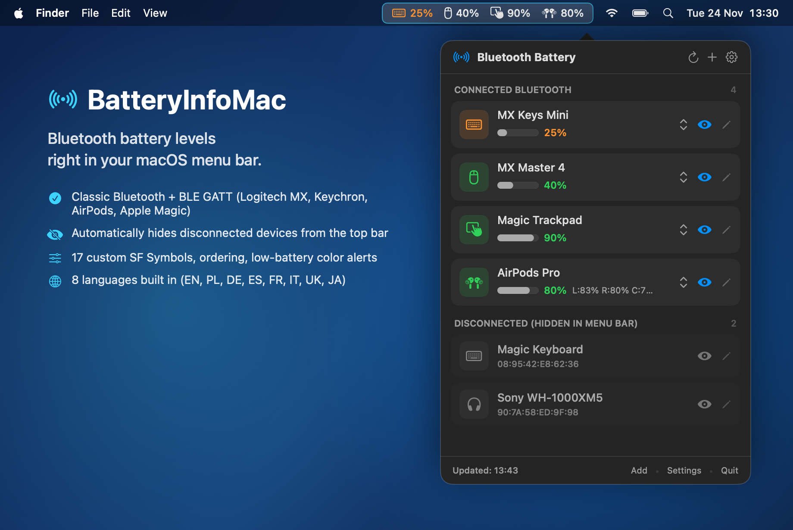
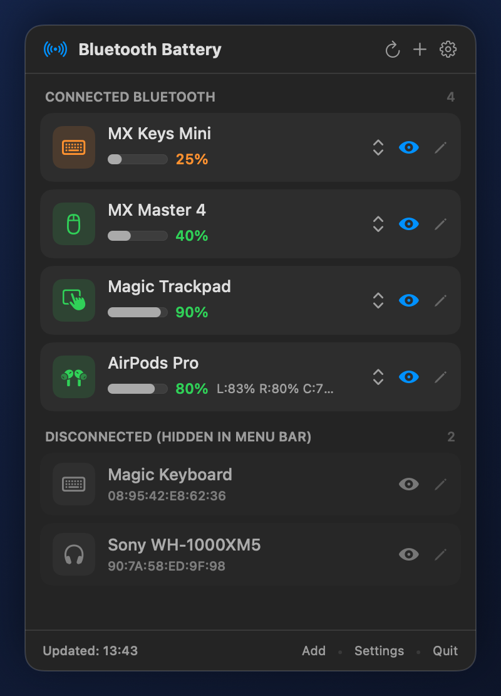
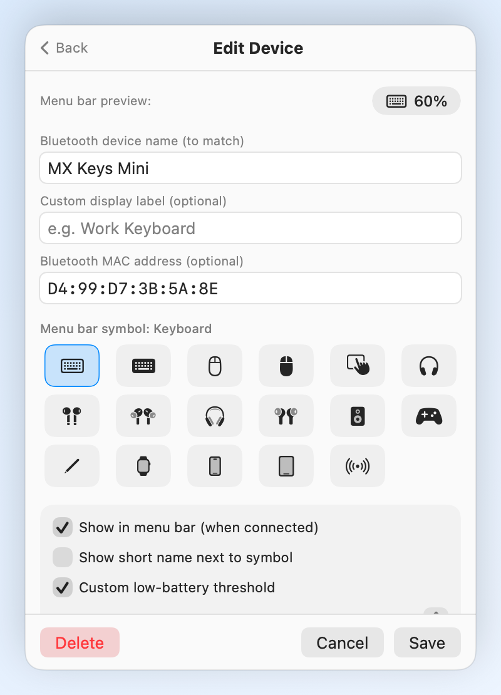
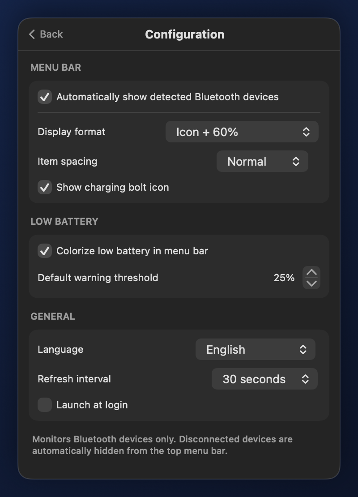

<p align="center">
  
</p>

<h1 align="center">BatteryInfoMac</h1>

<p align="center">
  <strong>Lightweight, native macOS menu bar utility that displays battery levels of connected Bluetooth devices with custom symbols and percentages.</strong>
</p>

<p align="center">
  <a href="README.pl.md">🇵🇱 Wersja polska (README.pl.md)</a> •
  <a href="#installation">Installation</a> •
  <a href="#features">Features</a> •
  <a href="#screenshots">Screenshots</a> •
  <a href="#building-from-source">Build from Source</a> •
  <a href="LICENSE">MIT License</a>
</p>

<p align="center">
  
  
  
  
  
</p>

---

<p align="center">
  
</p>

## Features

- **Bluetooth-Only Monitoring** — Exclusively tracks Bluetooth peripherals (never clutters your menu bar with your MacBook's internal battery or wired USB accessories).
- **Full Classic Bluetooth + BLE GATT Support** — Reads battery telemetry from:
  - **CoreBluetooth GATT Battery Service (`0x180F` / `0x2A19`)** — works seamlessly with **Logitech MX Keys / MX Keys Mini / MX Master 3S / MX Master 4**, **Keychron**, and other Bluetooth Low Energy keyboards & mice.
  - **IOKit HID & IOBluetooth** — works seamlessly with **Apple Magic Keyboard, Magic Mouse, Magic Trackpad**.
  - **`system_profiler SPBluetoothDataType`** — works with **AirPods / AirPods Pro / AirPods Max** (including Left / Right / Case breakdown), Sony, Bose, Beats, speakers, and gamepads.
- **Auto-Hide When Disconnected** — If a Bluetooth device is turned off or out of range, it automatically disappears from the top menu bar and reappears the moment it reconnects.
- **Click to Add, Edit & Configure** — Click the menu bar status at any time to:
  - Show/hide individual devices or change their left-to-right order in the menu bar.
  - Add paired devices or configure custom Bluetooth devices by name or MAC address.
  - Choose from **17 crisp SF Symbols** (keyboard, mouse, trackpad, AirPods, headphones, speaker, controller, stylus, etc.).
  - Customize display format (`⌨ 60%`, compact `⌨ 60`, or `⌨ Name 60%`), icon spacing, low-battery color warnings, refresh interval, and Launch at Login.
- **Multi-Language UI (8 Languages)** — Automatic macOS system language detection plus instant in-app switching:
  - 🇬🇧 English, 🇵🇱 Polski, 🇩🇪 Deutsch, 🇪🇸 Español, 🇫🇷 Français, 🇮🇹 Italiano, 🇺🇦 Українська, 🇯🇵 日本語.
- **Native & Lightweight** — Zero Electron, zero external dependencies, pure Swift + AppKit + SwiftUI (`LSUIElement` menu bar agent with no Dock icon).

## Screenshots

| Connected Devices Panel | Edit Device & Symbol Picker | Settings & Languages |
| :---: | :---: | :---: |
|  |  |  |

## Installation

### Option 1: macOS DMG Installer (Recommended)

1. Download the latest `BatteryInfoMac-1.1.0-universal.dmg` from the [GitHub Releases](https://github.com/krulkamyl/BatteryInfoMac/releases) page.
2. Open the downloaded `.dmg` file.
3. Drag **BatteryInfoMac.app** into the **Applications** folder.
4. Launch **BatteryInfoMac** from Applications or Spotlight.

> **First Launch (Unsigned Open-Source Build):**
> Because this open-source app is ad-hoc signed rather than notarized with a paid Apple Developer ID, macOS Gatekeeper may show a warning on first launch. To open it:
> - **Right-click** `BatteryInfoMac.app` in Applications → **Open** → **Open**, **or**
> - Run in Terminal:
>   ```bash
>   xattr -dr com.apple.quarantine /Applications/BatteryInfoMac.app
>   open /Applications/BatteryInfoMac.app
>   ```

> **Bluetooth Permission:**
> On first launch, macOS will prompt for **Bluetooth access** for `BatteryInfoMac`. Click **Allow** so the app can read BLE battery levels (such as Logitech MX keyboards & mice) via CoreBluetooth.

### Option 2: Install from Source (One Command)

Requires macOS 14.0+ and Xcode Command Line Tools (`xcode-select --install`):

```bash
git clone https://github.com/krulkamyl/BatteryInfoMac.git
cd BatteryInfoMac
./scripts/install.sh
```

This builds a Universal Binary (Apple Silicon + Intel), copies `BatteryInfoMac.app` into `/Applications`, and launches it immediately.

## Building from Source

### Build `.app` bundle only

```bash
./scripts/build_app.sh
open BatteryInfoMac.app
```

To build only for your current architecture (faster):

```bash
BUILD_ARCH=arm64 ./scripts/build_app.sh
```

### Build `.dmg` installer (Universal Binary + SHA-256)

```bash
./scripts/create_dmg.sh
```

The installer and checksum will be generated in `dist/`:
- `dist/BatteryInfoMac-1.1.0-universal.dmg`
- `dist/BatteryInfoMac-1.1.0-universal.dmg.sha256`

## Requirements

- **macOS 14.0 (Sonoma)** or later (tested on macOS 14, 15, and 26)
- **Apple Silicon** (`arm64`) or **Intel** (`x86_64`)

## Supported Languages

| Language | Code | Status |
| :--- | :---: | :---: |
| Auto (macOS System Language) | `system` | Built-in |
| English | `en` | Built-in |
| Polski | `pl` | Built-in |
| Deutsch | `de` | Built-in |
| Español | `es` | Built-in |
| Français | `fr` | Built-in |
| Italiano | `it` | Built-in |
| Українська | `uk` | Built-in |
| 日本語 | `ja` | Built-in |

Want to add your language? See [CONTRIBUTING.md](CONTRIBUTING.md)!

## License

Released under the [MIT License](LICENSE).
