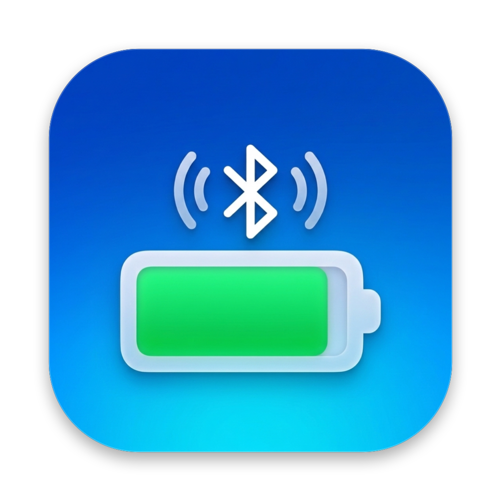
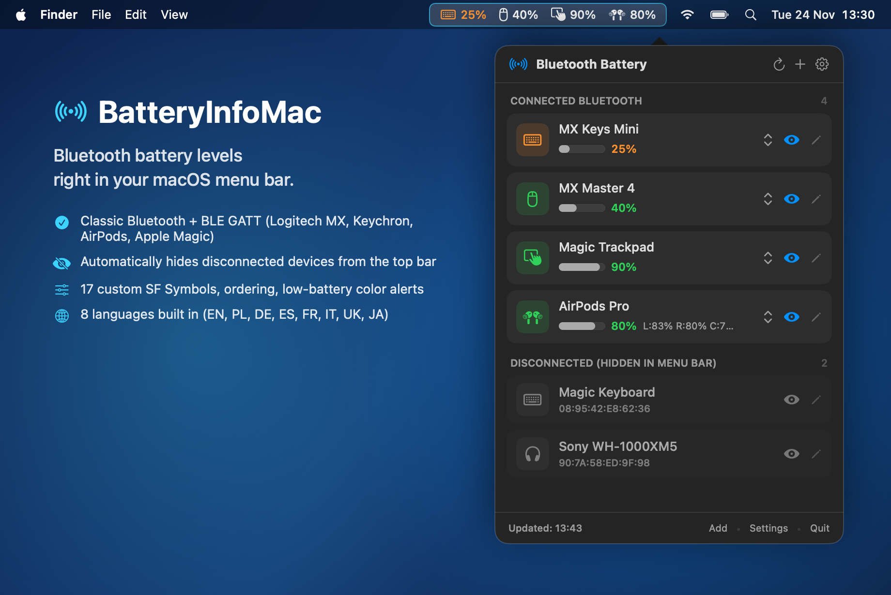
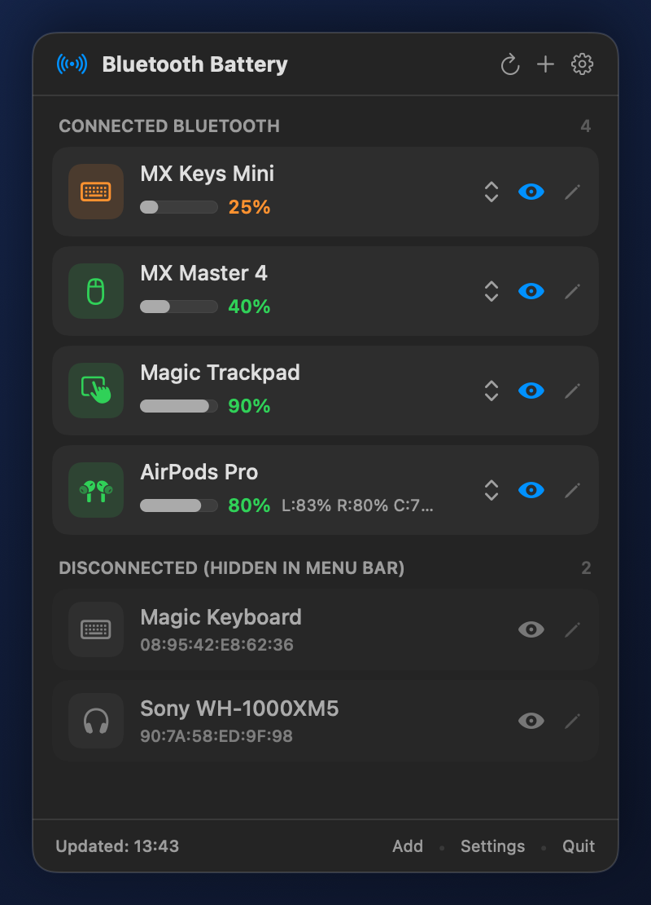
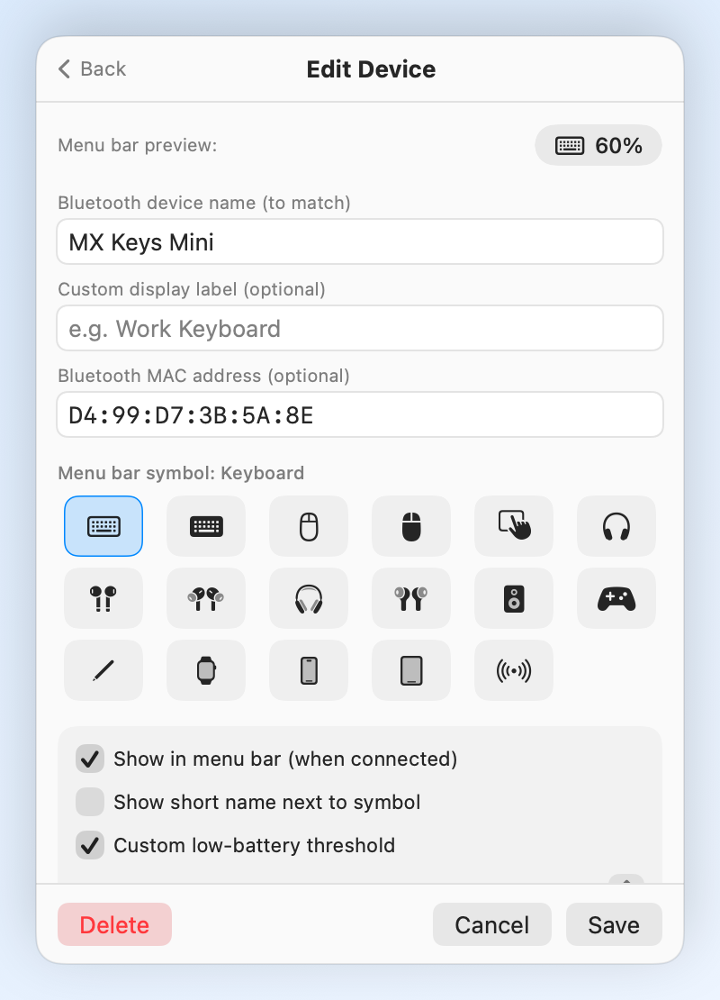
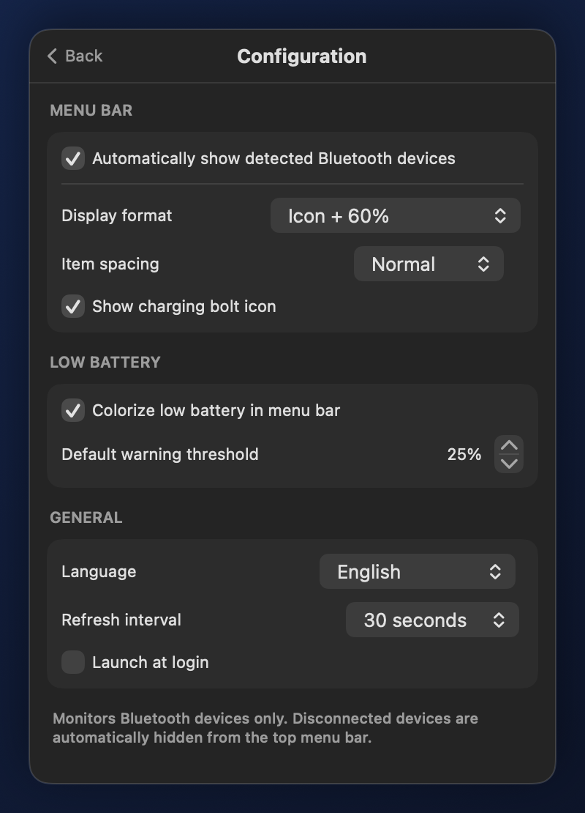

<p align="center">
  
</p>

<h1 align="center">BatteryInfoMac</h1>

<p align="center">
  <strong>Lekka, natywna aplikacja na pasek górny macOS pokazująca stan naładowania podłączonych urządzeń Bluetooth wraz z symbolem i procentami.</strong>
</p>

<p align="center">
  <a href="README.md">🇬🇧 English Version (README.md)</a> •
  <a href="#instalacja">Instalacja</a> •
  <a href="#funkcje">Funkcje</a> •
  <a href="#zrzuty-ekranu">Zrzuty ekranu</a> •
  <a href="#budowanie-ze-źródeł">Budowanie ze źródeł</a> •
  <a href="LICENSE">Licencja MIT</a>
</p>

---

<p align="center">
  
</p>

## Funkcje

- **Tylko urządzenia Bluetooth** — monitoruje wyłącznie akcesoria Bluetooth (pomija wewnętrzną baterię MacBooka oraz urządzenia przewodowe USB).
- **Pełne wsparcie Classic Bluetooth + BLE GATT**:
  - **CoreBluetooth GATT Battery Service (`0x180F` / `0x2A19`)** — pełne wsparcie dla **Logitech MX Keys / MX Keys Mini / MX Master 3S / MX Master 4**, **Keychron** i innych klawiatur oraz myszek Bluetooth Low Energy.
  - **IOKit HID & IOBluetooth** — **Apple Magic Keyboard, Magic Mouse, Magic Trackpad**.
  - **`system_profiler SPBluetoothDataType`** — **AirPods / AirPods Pro / AirPods Max** (z rozbiciem na Lewą / Prawą słuchawkę oraz Etui), słuchawki Sony/Bose/Beats, głośniki i kontrolery.
- **Automatyczne ukrywanie odłączonych urządzeń** — gdy urządzenie Bluetooth zostanie wyłączone lub straci zasięg, automatycznie znika z paska górnego i pojawia się ponownie po połączeniu.
- **Dodawanie, edycja i konfiguracja po kliknięciu**:
  - Szybkie ukrywanie/pokazywanie wybranych urządzeń oraz zmiana kolejności na pasku górnym.
  - Dodawanie sparowanych urządzeń lub ręczne dodawanie po nazwie / adresie MAC.
  - Wybór spośród **17 symboli SF Symbols** (klawiatura, myszka, gładzik, AirPods, słuchawki, głośnik, pad, rysik itd.).
  - Format wyświetlania (`⌨ 60%`, kompaktowy `⌨ 60` lub `⌨ Nazwa 60%`), odstęp między ikonami, kolorowanie niskiego poziomu baterii, interwał odświeżania i autostart z macOS.
- **Wiele języków (8 wbudowanych)** — automatyczne wykrywanie języka systemu macOS oraz możliwość ręcznej zmiany w Ustawieniach bez restartu:
  - 🇵🇱 Polski, 🇬🇧 English, 🇩🇪 Deutsch, 🇪🇸 Español, 🇫🇷 Français, 🇮🇹 Italiano, 🇺🇦 Українська, 🇯🇵 日本語.
- **Natywna i lekka** — napisana w czystym Swift (AppKit + SwiftUI), bez Electrona, bez ikony w Docku.

## Zrzuty ekranu

| Panel urządzeń Bluetooth | Edycja i wybór symbolu | Ustawienia i wybór języka |
| :---: | :---: | :---: |
|  |  |  |

## Instalacja

### Opcja 1: Instalator macOS DMG (zalecana)

1. Pobierz najnowszy plik `BatteryInfoMac-1.1.0-universal.dmg` z zakładki [Releases](https://github.com/krulkamyl/BatteryInfoMac/releases).
2. Otwórz pobrany obraz `.dmg`.
3. Przeciągnij **BatteryInfoMac.app** do folderu **Applications (Aplikacje)**.
4. Uruchom **BatteryInfoMac** z folderu Aplikacje lub przez Spotlight.

> **Pierwsze uruchomienie (aplikacja Open Source bez płatnego podpisu Apple Developer):**
> Jeśli macOS wyświetli komunikat Gatekeeper:
> - Kliknij prawym przyciskiem `BatteryInfoMac.app` → **Otwórz** → **Otwórz**, **lub**
> - Wpisz w Terminalu:
>   ```bash
>   xattr -dr com.apple.quarantine /Applications/BatteryInfoMac.app
>   open /Applications/BatteryInfoMac.app
>   ```

> **Uprawnienia Bluetooth:**
> Przy pierwszym uruchomieniu macOS poprosi o zgodę na dostęp do **Bluetooth** dla `BatteryInfoMac`. Kliknij **Zezwól**, aby aplikacja mogła odczytywać baterię urządzeń BLE (m.in. Logitech MX).

### Opcja 2: Instalacja ze źródeł (jednym poleceniem)

Wymaga macOS 14.0+ oraz Xcode Command Line Tools (`xcode-select --install`):

```bash
git clone https://github.com/krulkamyl/BatteryInfoMac.git
cd BatteryInfoMac
./scripts/install.sh
```

Skrypt skompiluje wersję Universal (Apple Silicon + Intel), zainstaluje ją w `/Applications` i od razu uruchomi.

## Budowanie ze źródeł

### Zbudowanie samej aplikacji `.app`

```bash
./scripts/build_app.sh
open BatteryInfoMac.app
```

### Zbudowanie instalatora `.dmg` (Universal + SHA-256)

```bash
./scripts/create_dmg.sh
```

Gotowy instalator zostanie zapisany w katalogu `dist/`:
- `dist/BatteryInfoMac-1.1.0-universal.dmg`
- `dist/BatteryInfoMac-1.1.0-universal.dmg.sha256`

## Licencja

Projekt dostępny na licencji [MIT](LICENSE).
